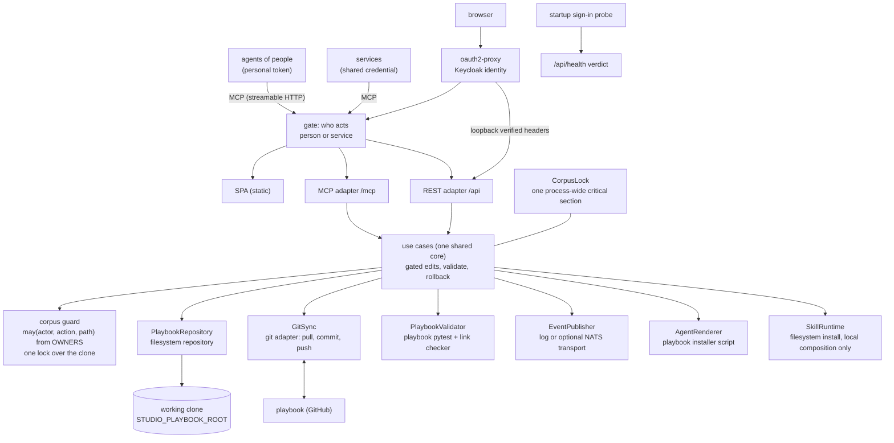

The studio is a hexagonal (ports and adapters) application. One shared core of use cases implements every capability; the SPA, the REST API, and the MCP server are inbound adapters over the same inbound ports, and six outbound ports isolate persistence, validation, git, event publication, agent rendering, and runtime skill installation. Capability wiring happens once, in the composition root. Human identity is resolved once at the HTTP boundary from the loopback oauth2-proxy peer; authorization and per-request git authorship then travel through the same core rather than being reimplemented by an adapter.

## Who acts

The gate in front of every route resolves who a request acts as ([ADR-010](../../decisions/adr-010/), [ADR-012](../../decisions/adr-012/)): on the human door, the person the OIDC sidecar forwards over the pod's loopback hop; on the machine door, the person a personal token names, or the service for the shared credential; standing alone, the Basic gate's holder, who is the service. The adapters hand that actor to every use case. Each write use case asks the corpus guard `may(actor, action, path)` with its target before it touches the clone ([ADR-011](../../decisions/adr-011/)), so both doors give the same answer and a refusal names the role needed. Reads carry `can_edit` from the same rights.

## The gated-edit path

Every write, whether it arrives from the SPA, a REST call, or an MCP tool, follows the identical path: check the rights, then, under the corpus lock, write to the working clone, regenerate what the corpus derives, run the playbook's own gates over a throwaway copy of the clone (so code the suite runs never touches the clone, [ADR-011](../../decisions/adr-011/)), roll back byte-identical on failure, commit on success with the actor as the commit's author ([ADR-013](../../decisions/adr-013/)). Trust calibration is enforced in one place; no adapter carries its own rules.

One process-wide lock spans each write's whole transaction, and push, refresh, the content poll and the install bundle's read take it too, so every commit holds exactly one person's change ([ADR-014](../../decisions/adr-014/)). Write handlers and MCP write tools run on worker threads, so a long validation never holds the event loop or the health check.

In proxy mode, the REST adapter accepts a human identity only from the
loopback sidecar peer and rejects unknown roles before a write reaches body
validation. The shared corpus lock covers the whole gated edit and sync path,
so an HTTP writer, MCP writer, or upstream poll cannot interleave authorship
or rollback state.

The regeneration step is the playbook's own `scripts/sync_backlinks.py`, which owns the back-link sections a write's frontmatter is quoted in. It runs before the gates read the corpus, so they judge a corpus consistent with the write rather than refusing it for a staleness the write itself caused. The script rejects the same malformed documents the gates reject, so a refusal from it is a refusal of the write, carrying its output and rolling the write back like any other. Rollback restores the bytes of every REF the regeneration rewrote, which is why the write path snapshots them before it runs.

## The client-executes idiom

The server owns its datastore; client-side effects ship as content the calling agent executes. A skill install over MCP returns the skill's files and the calling agent writes them to its own runtime directory; the browser's install button copies the ask that installs it. Agent file delivery uses the playbook's installer through the agent-rendering port. The whole toolchain ships the same way at scale: `get_install_command` returns one shell line that downloads every skill and every rendered agent as one bundle, with the playbook's installer inside it, and that installer applies the bundle on the calling machine. Local composition also exposes an HTTP runtime skill install into the local runtime directory; managed deployments and MCP use file delivery.

## Composition, not conditionals

The composition root decides which use cases exist in a given deployment. The deployed studio wires the real git adapter (authenticated against the content repo); the local run wires a no-op sync adapter over the sibling checkout. Use cases never branch on where they run.

## The nebula quarantine

The corpus's `nebulae/` zone holds unearned research (stardust, written by the Forge) beside the earned galaxies. The studio serves it to humans only: `/api/nebulae` lists the territories and `/api/nebulae/{territory}` returns the fronting NEBULA.md plus every note's frontmatter and body, and the maps render each nebula as a dim, second-class body. The quarantine is structural on the machine side: the repository's discovery globs never reach into `nebulae/`, the reference graph carries no nebula node or edge, and the MCP adapter registers no nebula tool, so no connected agent can mistake stardust for doctrine.

## Read next

- [Decisions](../../decisions/): the decision records behind the port boundaries and the MCP adapter.
