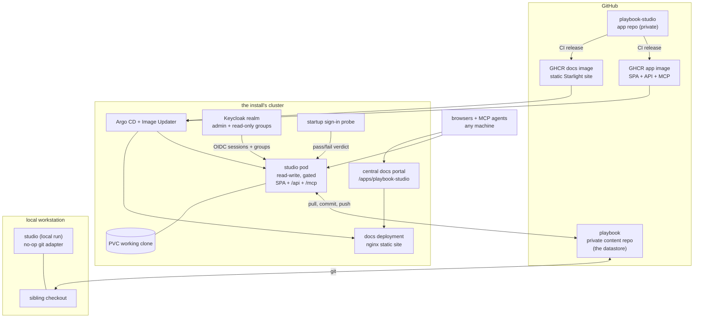

The studio is an application repo deployed on the Foundry install that runs it; the playbook content lives in a separate private repository that the deployed studio clones at runtime and manages through git. The same application runs locally against a sibling checkout.

## The two repositories

- **`playbook`** is the datastore. Its version history, audit trail, and merge semantics are git itself. The deployed studio clones it onto a PersistentVolumeClaim on first start, pulls to stay at head, and pushes accepted edits.
- **`playbook-studio`** (this repo) is the application. CI releases the app and docs images and the chart to GHCR; Argo CD reconciles their separate deployments. The app image carries no playbook content; the docs image serves the built documentation through nginx.

## The app image

The app image is one Python runtime serving the SPA, `/api`, and `/mcp`. Every gated edit runs the playbook's own validation suite inside the pod, over a copy of the clone, as the image's unprivileged `gates` user and without the studio's settings in its environment ([ADR-011](../../decisions/adr-011/)), so the image carries what that suite and the write path call at run time:

The human door receives identity from the app's Keycloak realm through
oauth2-proxy. The API trusts those headers only from the sidecar loopback
peer; `/mcp` continues to use the shared Basic credential. The startup probe
checks the public OIDC round trip and publishes only its verdict through
health.

- **git**: the deployed studio clones the content repo onto the PVC, and every accepted edit becomes a commit ([ADR-001](../../decisions/adr-001/), [ADR-002](../../decisions/adr-002/)).
- **The gates extra** (`pytest` and `pytest-intent`): the studio runs the playbook's intent-test suite with its own interpreter.
- **Node**: that suite runs the playbook's deck layout gate with `node`. The image takes the binary from its Node build stage, and the image build fails if `node` is missing.

A gate the image cannot run fails the suite, and every gated edit is rolled back, whatever it changed.

## Identity in the pod

The studio pod runs two containers: the app and the oauth2-proxy sidecar. The sidecar signs a person in against the app's Keycloak realm and forwards their requests to the app over loopback, naming them in `X-Forwarded-Email` and `X-Forwarded-Preferred-Username`, beside a Basic header whose password is the proxy secret both containers read from the app's auth Secret. The app runs with `--no-proxy-headers` and trusts those headers only from that loopback hop carrying that secret, never on `/mcp`, which the sidecar passes through untouched ([ADR-010](../../decisions/adr-010/)). Machine clients reach `/mcp` with a person's personal token, signed with `STUDIO_TOKEN_KEY` from the app's auth Secret, or the shared Basic credential that acts as the service ([ADR-012](../../decisions/adr-012/)). Who may change what is the playbook's own `OWNERS` file, read from the clone ([ADR-011](../../decisions/adr-011/)).

## Delivery

The app follows the standard Foundry app contract: a push to `main` triggers CI, semantic-release cuts the version, the two images and chart publish to GHCR, Argo CD Image Updater promotes each image tag through the app's `deploy-<install>` branch, and Argo CD syncs the cluster. The [Helm chart](https://github.com/VFPT-VODAFONE-FOUNDRY/adf-playbook-studio/tree/main/k8s) owns image bindings, Services, and deployment configuration.

## The local run

Locally the studio points `STUDIO_PLAYBOOK_ROOT` at the sibling `playbook` checkout and wires a no-op git adapter: the studio edits the working tree and the operator commits with their own tools. Same application, different composition.

## Read next

- [Hexagonal architecture](../../architecture/hexagon/): inside the pod, one core and three doors.
- [Decisions](../../decisions/): why the content is pulled at runtime and never baked in.
