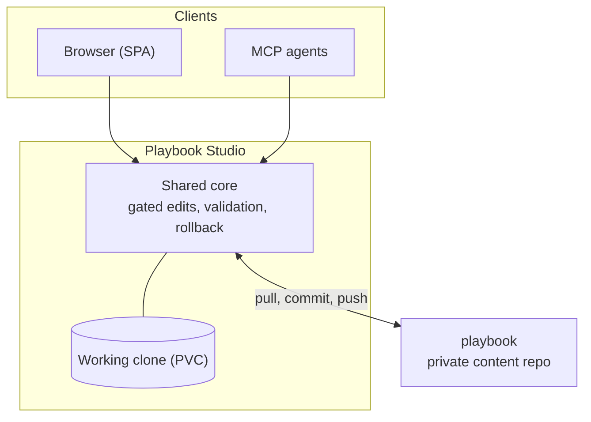

Playbook Studio is the management surface for the AI playbook: the private `playbook` repository that holds the universe - the playbook index, its galaxies, and each galaxy's REFs (with their declared doors), skills, and agents. The studio renders the corpus as a navigable graph, gates every edit behind the playbook's own validation suite, installs skills into agent runtimes, and exposes the whole capability set to humans (SPA), scripts (REST), and agents (MCP). It is where every delivery worker pulls its skill from at run time, so the corpus it guards is the instruction set the whole delivery lifecycle runs on.

## What it does

- **Reads**: the reference graph, playbook sections, galaxies and their routing tables, REF documents and declared doors, skills and their files, the agent roster, intent claims, and the validation report.
- **People and rights**: everyone acts as themselves. The playbook's own `OWNERS` file says who may change what (admins, galaxy writers, owners of a skill, agent or card; everyone else reads), one rights function answers for both doors, and every commit names the person who made it.
- **Gated writes**: every mutation runs the playbook's deterministic gates (intent tests plus link checker) and restores the prior state byte-identical when they fail. An accepted edit becomes a local git commit; a deliberate push publishes accumulated commits.
- **Skill delivery**: skills install into the local agent runtime; MCP clients receive skill files and write them with their own hands.

## Where it runs

One application serves three inbound doors from a single deployment: the SPA, the REST API under `/api`, and the MCP server under `/mcp`. Deployed with the chart's OIDC gate (the default), oauth2-proxy fronts the human surfaces against the app's own Keycloak realm and fail-closed HTTP Basic narrows to the `/mcp` machine door (`STUDIO_AUTH_SCOPE=mcp`); stood up alone, the Basic gate covers all three. On the machine door a person connects with their own personal token, minted from the Connect menu; the shared Basic credential is the service's. The same application runs locally against a sibling checkout of the content repo.

## Read next

- [System context](architecture/system-context/): how the studio, the content repo, and the cluster fit together.
- [Hexagonal architecture](architecture/hexagon/): the shared core and its three inbound adapters.
- [MCP tools](reference/tools/): the full tool surface an agent drives.
- [Decisions](decisions/): the decision log behind this shape.
